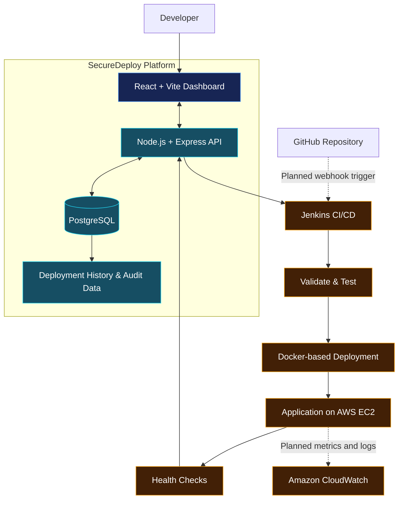


<div align="center">

# ⚡ SecureDeploy

### Ship Faster. Deploy Reliably. Monitor Everything.

A cloud-native deployment and operations platform designed to simplify application delivery, automate CI/CD workflows, and bring deployment health and diagnostics into one unified dashboard.

<br/>


<br/>

**[Repository](https://github.com/Spandanchoubey9/SecureDeploy)** · **Cloud-Native Engineering** · **DevOps Automation**

</div>

---

## Overview

Modern application delivery involves more than building and deploying code. Developers must coordinate CI/CD pipelines, manage deployment state, verify application availability, investigate failures, and understand infrastructure health.

**SecureDeploy aims to bring these workflows together in one platform.**

Built with React, Node.js, PostgreSQL, Docker, Jenkins, and AWS, SecureDeploy provides a foundation for deployment management and cloud-native operations. Its long-term goal is to let developers manage their own application projects, automate releases from GitHub, and investigate deployment and runtime issues without jumping between multiple tools.

> **Project status:** Deployment management, the application stack, and CI/CD integration form the current foundation. Multi-user project isolation, GitHub webhook automation, and comprehensive monitoring are planned extensions unless verified as implemented in the repository.

## Why SecureDeploy?

| Traditional workflow | SecureDeploy's goal |
|---|---|
| Deployment information is spread across tools | Centralized deployment visibility |
| Manual releases are difficult to reproduce | Repeatable CI/CD workflows |
| Successful builds can still produce unhealthy releases | Post-deployment health validation |
| Failures require searching multiple logs | Unified deployment diagnostics |
| Infrastructure issues are difficult to correlate with releases | Infrastructure and application observability |
| Every application needs a separate operational workflow | Project-centric application management |

---

## Architecture



### Technology Stack

| Component | Technology | Purpose |
|---|---|---|
| Frontend | React, Vite | Interactive deployment and operations dashboard |
| Backend | Node.js, Express | API layer and application logic |
| Database | PostgreSQL | Persistent application and deployment data |
| Containerization | Docker, Docker Compose | Consistent service environments |
| CI/CD | Jenkins | Pipeline orchestration and deployment automation |
| Cloud infrastructure | AWS EC2 | Application hosting |
| Observability | Amazon CloudWatch — planned expansion | Infrastructure metrics, logs, and alarms |

---

## Core Capabilities

<table>
<tr>
<td width="50%" valign="top">

### 🚀 Deployment Management

- Deployment history and status visibility
- Persistent deployment records
- A foundation for release tracking
- Planned project-specific deployment configuration

</td>
<td width="50%" valign="top">

### 🔄 CI/CD Automation

- Jenkins pipeline integration
- Automated validation and deployment stages
- Pipeline result reporting
- Planned GitHub webhook triggers

</td>
</tr>
<tr>
<td width="50%" valign="top">

### ☁️ Cloud-Native Infrastructure

- AWS EC2 deployment environment
- Docker-based application services
- Docker Compose configuration
- Planned infrastructure metrics and alerting

</td>
<td width="50%" valign="top">

### 📊 Operational Intelligence

- Planned system health monitoring
- Backend error tracking
- Infrastructure visibility
- Deployment diagnostics and health correlation

</td>
</tr>
</table>

---

## Deployment Lifecycle

The intended end-to-end workflow connects source code, pipeline execution, deployment, and runtime validation.


| Stage | Intended responsibility |
|---|---|
| Source | Identify the repository, branch, and revision |
| Trigger | Start a release manually or through a future GitHub webhook |
| Build & Test | Execute the configured Jenkins pipeline stages |
| Deploy | Deploy to an authorized target |
| Health Check | Verify that the application responds after deployment |
| Report | Associate results with the corresponding deployment record |
| Monitor | Correlate runtime health, errors, and infrastructure signals |

The exact workflow depends on the current Jenkinsfile and integration configuration. The diagram represents the target lifecycle, not a claim that every stage is already fully automated.

---

## Roadmap

The development strategy is to evolve SecureDeploy from a deployment dashboard into a **multi-user application delivery and maintenance platform**.

### 01 — Deployment Foundations
- Improve deployment status consistency and history.
- Standardize pipeline result reporting and failure details.
- Refine API, database, and callback integration.
- Improve setup instructions and error visibility.

### 02 — Multi-User Projects
- Create and manage multiple application projects.
- Connect GitHub repositories and configure branches.
- Associate projects and deployments with their owners.
- Enforce project-level authorization.
- Isolate logs, settings, credentials, and deployment history.

### 03 — Automated CI/CD
- Integrate GitHub webhooks.
- Use an always-on CI/CD runner or hosted pipeline service.
- Associate pipeline runs with the correct project and commit.
- Display pipeline stages, execution duration, and failure details.
- Add reliable callbacks, retry handling, and post-deployment validation.

### 04 — Monitoring & Diagnostics
- **System health:** API, database, Jenkins, application availability, and response time.
- **Error monitoring:** Backend exceptions, failed requests, and deployment failures.
- **Infrastructure monitoring:** CPU, memory, disk, network, and container status.
- **Deployment diagnostics:** Pipeline logs, stage duration, deployment output, and health-check results.
- **CloudWatch integration:** Metrics, logs, and configurable alarms for supported AWS resources.

### 05 — Production Readiness
- Tenant isolation and server-side authorization.
- Secure credential and integration management.
- Isolated build and deployment execution.
- HTTPS, rate limits, and audit trails.
- Backups, recovery procedures, resource quotas, and AWS cost controls.

---

## Security & Reliability

SecureDeploy is intended to manage application deployments safely, not merely trigger commands on a server.

| Principle | Engineering objective |
|---|---|
| Access control | Enforce authorization on every protected API operation |
| Tenant isolation | Prevent users from accessing other users' projects and data |
| Least privilege | Limit AWS and CI/CD permissions to required operations |
| Secret protection | Keep tokens, private keys, and environment secrets out of source control |
| Safe execution | Isolate deployment workloads and restrict arbitrary command execution |
| Infrastructure security | Restrict public access to databases and administrative interfaces |
| Auditability | Record meaningful deployment actions and state changes |
| Cost awareness | Apply quotas, monitoring, and resource-lifecycle controls |

These are implementation and production-hardening objectives, not a claim of formal security certification.

---

## Getting Started

### Prerequisites

- Git
- Node.js and npm
- Docker Desktop and Docker Compose
- Access to the configured PostgreSQL service
- AWS and Jenkins configuration for testing the corresponding integrations

### 1. Clone the repository

```bash
git clone https://github.com/Spandanchoubey9/SecureDeploy.git
cd SecureDeploy
```

### 2. Configure the environment

Review the environment example files and Compose configuration in the repository.

- Configure the PostgreSQL connection.
- Set required application secrets locally.
- Configure Jenkins and AWS integrations only if needed.
- Never commit real credentials, private keys, or `.env` files.

### 3. Start the application

If the root Compose file defines the required local services:

```bash
docker compose up --build
```

Otherwise, use the scripts defined in the frontend and backend `package.json` files to start the services individually.

> **Note:** Confirm the current Compose filename, scripts, environment variables, and port mappings before running these commands. The exact local setup depends on the repository configuration.

---

## Engineering Challenges

SecureDeploy explores practical challenges in cloud-native application delivery:

- Synchronizing asynchronous CI/CD runs with persistent deployment records.
- Keeping deployment state consistent across the frontend, backend, database, and Jenkins callbacks.
- Distinguishing build success from actual application health.
- Designing project ownership and access control for multi-user deployment management.
- Correlating release events with application errors and infrastructure metrics.
- Protecting cloud credentials and controlling deployment execution.

These problems make SecureDeploy more than a basic CRUD dashboard: its intended direction involves orchestration, distributed state, cloud infrastructure, and operational reliability.

---

## Future Vision

The long-term objective is a developer-facing control plane where users can:

- Connect GitHub repositories and create application projects.
- Configure deployment branches and authorized targets.
- Trigger repeatable CI/CD workflows.
- Inspect release history, pipeline stages, logs, and failures.
- Monitor application health, backend errors, and cloud infrastructure.
- Diagnose deployment issues from a unified operational view.

The central idea is simple:

**SecureDeploy should help developers understand not only whether an application was deployed, but also whether it is running correctly and what to investigate when it is not.**

---

## Author

**Spandan Choubey**  
Computer Science & Engineering

[](https://github.com/Spandanchoubey9)

**Repository:** [SecureDeploy](https://github.com/Spandanchoubey9/SecureDeploy)

<div align="center">

---

*SecureDeploy — From code commit to confident release.*

</div>
