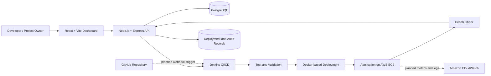



SecureDeploy
Ship with confidence. See what happens after the deploy.
A cloud-native deployment and operations platform for connecting source code to repeatable deployments, tracking release health, and bringing deployment diagnostics and infrastructure visibility into one place.

  
  
  
  
  
  

Built to evolve from a deployment dashboard into a multi-user application delivery and maintenance platform.

The problem
Deploying an application is only one part of running it. Teams also need to know whether a release passed its pipeline, whether the application is responding, what failed, and where to look when something goes wrong. These signals are often spread across CI/CD logs, cloud dashboards, containers, and application output.
SecureDeploy brings deployment activity and operational visibility into one workflow. The project combines a web dashboard, backend API, PostgreSQL persistence, containerized services, and a Jenkins-based delivery workflow, with a roadmap toward isolated, multi-user project management and deeper monitoring.
Project status: This repository is an evolving engineering project. The current implementation provides the foundation for deployment management and CI/CD integration; several capabilities described in the roadmap are planned work, not claims of completed functionality.

At a glance
Area	Current foundation	Direction
Application dashboard	React-based interface	Project-centric overview and operational summaries
API and persistence	Express backend with PostgreSQL	Tenant-aware APIs, authorization, and auditability
Delivery automation	Jenkins pipeline integration	GitHub-triggered, repeatable project deployments
Runtime packaging	Docker / Docker Compose	Safer, isolated deployment targets
Cloud hosting	AWS EC2 deployment environment	Managed infrastructure and CloudWatch-backed visibility
Diagnostics	Deployment status and pipeline workflow	Correlated logs, errors, health checks, and release diagnostics

Architecture

The diagram shows the intended end-to-end direction. GitHub webhook automation, multi-tenant project isolation, and full CloudWatch/application monitoring should be treated as roadmap items unless verified in the current code.
Technology choices
- React + Vite — dashboard UI and fast frontend development.
- Node.js + Express — API endpoints and orchestration between the dashboard, database, and delivery workflow.
- PostgreSQL — persistent application data, including users, deployments, and audit-related records in the current project foundation.
- Docker + Docker Compose — repeatable local and server-side service environments.
- Jenkins — pipeline orchestration for validation, deployment, health checks, and status callbacks.
- AWS EC2 — cloud-hosted application environment.
- Amazon CloudWatch (planned expansion) — infrastructure metrics, logs, alarms, and operational signals.
What the platform is designed to do
1. Deployment lifecycle visibility
Track deployment records and outcomes from a single dashboard. The intended workflow connects a project and source revision to pipeline execution, deployment status, and post-deployment validation.
2. CI/CD integration
Use Jenkins to automate repeatable delivery tasks rather than relying on manual server changes. The pipeline direction includes validation, tests, deployment, health checks, and reporting the outcome back to SecureDeploy.
3. Operational monitoring — planned expansion
Bring together system health and runtime signals, rather than treating a successful build as proof that an application is healthy.
- System health: API and database availability, Jenkins connectivity, application reachability, response time, and last-check timestamps.
- Error monitoring: backend exceptions, failed requests, failed deployments, and actionable error context.
- Infrastructure monitoring: CPU, memory, disk, network, and container status.
- Deployment diagnostics: build duration, pipeline stages, relevant logs, deployment output, and health-check results.
These are target capabilities; the completeness of each signal depends on implementation and configuration.
4. Multi-user deployment platform — planned expansion
The longer-term goal is for other developers to use SecureDeploy for their own applications, not just to operate SecureDeploy itself. A project owner should be able to connect a repository, configure a branch and deployment target, trigger a release, and inspect its status and diagnostics.
Roadmap
The roadmap is deliberately incremental: establish trustworthy project boundaries first, then automate delivery, then add richer observability.

<strong>Phase 1 — Product and data foundations</strong>

- Refine the dashboard around projects, releases, operational status, and recent activity.
- Audit existing API routes, database schema, and pipeline contracts before adding new abstractions.
- Define consistent deployment states, timestamps, error details, and audit events.
- Document setup and configuration based on the actual repository scripts and environment variables.

<strong>Phase 2 — Multi-user workspaces and projects</strong>

- Add workspace/project ownership and server-enforced access control.
- Build project creation and configuration for repository URL, branch, runtime/build settings, and authorized target.
- Scope deployments, logs, settings, and credentials to the correct project and user.
- Add validation, quotas, and clear permission boundaries.

<strong>Phase 3 — Automated delivery</strong>

- Add GitHub webhook-triggered workflows and repository connection management.
- Move CI/CD execution to an always-on runner or hosted CI/CD service; avoid depending on a developer laptop being online.
- Associate each pipeline run with the correct project, commit, and deployment record.
- Report stage results, logs, duration, health-check outcome, and failure reason to the dashboard.
- Make retries and duplicate webhook delivery safe and observable.

<strong>Phase 4 — Health, errors, and infrastructure observability</strong>

- Add scheduled application health checks and response-time history.
- Capture structured backend errors and failed-request context.
- Integrate CloudWatch metrics and logs for relevant AWS resources.
- Add configurable alarms for meaningful service degradation.
- Correlate a deployment with post-release health and error signals.

<strong>Phase 5 — Security and production readiness</strong>

- Enforce tenant isolation at the API and data-access layers.
- Store secrets server-side and never expose them in browser responses or logs.
- Isolate build and deployment execution; restrict permissions and target access.
- Add HTTPS, secure session/token handling, rate limits, audit trails, backups, and recovery procedures.
- Add deployment quotas, resource controls, and clear AWS cost safeguards.

Security and reliability principles
SecureDeploy's goal is not simply to make deployment possible; it is to make deployment controlled, traceable, and diagnosable.
- Server-side authorization: UI hiding is not access control. Every project, deployment, log, and settings request must be authorized by the backend.
- Tenant isolation: one user must not be able to enumerate or access another user's projects, releases, logs, or secrets.
- Least privilege: AWS and CI/CD credentials should have only the permissions needed for their task.
- Secret hygiene: keep credentials in environment configuration or a dedicated secret store; never commit .env files, private keys, API tokens, or callback secrets.
- Safe execution: do not execute arbitrary user-provided shell commands on the host. Build and deploy workloads need explicit boundaries and resource limits.
- Restricted infrastructure: database, backend, and Jenkins administration interfaces should not be exposed publicly without a deliberate, secure access design.
- Observable outcomes: record the release, pipeline result, health-check result, and failure context so that a failed deployment can be investigated.
These are design requirements and hardening goals; they should not be interpreted as a security certification.
Running the project locally
The exact commands and environment variable names can change with the repository. Check the current package.json scripts and Compose files before running these examples.
Prerequisites
- Git
- Node.js and npm
- Docker Desktop with Docker Compose
- Access to the configured PostgreSQL service
- Jenkins and AWS credentials only if testing those integrations
Get the source
git clone https://github.com/Spandanchoubey9/SecureDeploy.git
cd SecureDeploy
Start services
If the repository's root docker-compose.yml defines the required local services, use:
docker compose up --build
Otherwise, start the backend and frontend using the scripts documented in their respective package.json files and configure the database connection using your local environment file.
Configuration checklist
1. Create local environment files from the project's example files, if provided.
2. Configure the PostgreSQL connection string and required application secrets locally.
3. Verify which host ports are configured in the Compose file before starting services.
4. Keep real credentials out of Git; do not paste tokens or private keys into issues or documentation.
5. Start with the core application before configuring optional AWS or Jenkins integrations.
Deployment environment
The project has been exercised with an AWS EC2-based environment and a Docker Compose deployment configuration. The exact public endpoint and current instance state can change, so no live availability is implied by this README.
For a deployment environment, verify the following before exposing the application:
- Frontend traffic is served over HTTPS in production.
- Backend and database ports are not publicly reachable unless explicitly required and protected.
- Environment variables and credentials are configured on the host, not committed to source control.
- Health checks validate the application after deployment.
- Persistent database storage is backed up and retained during routine container updates.
- AWS budgets, billing alerts, and resource cleanup procedures are configured.
Suggested project structure
The repository's actual structure is authoritative; this is a conceptual view of the main responsibilities, not a guarantee that every path exists.
SecureDeploy/
├── frontend/          # React + Vite dashboard
├── backend/           # Express API and business logic
├── Jenkinsfile        # CI/CD pipeline definition
├── docker-compose.aws.yml
└── README.md
Engineering challenges this project explores
- Coordinating asynchronous CI/CD execution with persistent deployment records.
- Keeping deployment state consistent between a dashboard, API, database, and pipeline callbacks.
- Separating a successful build from a healthy running release.
- Designing a project model that can evolve from a single deployment environment to multi-user use.
- Turning infrastructure and application signals into useful operational diagnostics.
- Applying secure defaults to credentials, cloud access, deployment targets, and tenant boundaries.
Future direction
The intended end state is a developer-facing control plane where a user can connect a GitHub repository, configure an authorized deployment target, release an application through automated CI/CD, and then monitor its health, errors, infrastructure, and deployment history from one place.
The key distinction is that SecureDeploy is intended to manage other people's applications as projects, not only its own infrastructure. Achieving that requires project-level isolation, safe build execution, credential management, quotas, and reliable automation—not just additional dashboard cards.

SecureDeploy — from shipping code to understanding the health of every release.

